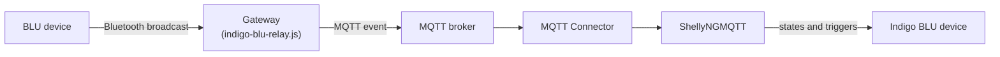

# BLU Relay

Shelly BLU devices (buttons, door/window sensors, motion sensors, and so on) talk over Bluetooth Low Energy, not Wi-Fi, so Indigo can't hear them directly. The BLU relay solves this by turning your Wi-Fi Shelly devices into Bluetooth gateways: a small script on each gateway listens for BLU broadcasts and forwards them to the plugin over MQTT.

This page explains how the relay works, what it does and doesn't do, and the security tradeoffs to understand before relying on BLU devices.

## How It Works

1. **The BLU device broadcasts.** BLU devices don't stay connected to anything. When something happens (a button press, a door opening) or on a regular interval, they send a short [BTHome](https://bthome.io) broadcast that anything nearby can hear.
2. **The gateway listens.** The relay script on each gateway runs a passive Bluetooth scan. For every BTHome broadcast it hears, it emits an `indigo-blu-relay` event containing the sender's MAC address, the signal strength (RSSI), and the raw broadcast data.
3. **The event travels over MQTT.** The gateway publishes the event to your broker through its normal RPC over MQTT connection, and MQTT Connector hands it to the plugin.
4. **The plugin decodes it.** The plugin looks up which Indigo devices use that MAC address, decodes the broadcast with the [bthome-ble](https://github.com/Bluetooth-Devices/bthome-ble) library, updates the device's states, and fires any matching button triggers.

The gateway only forwards raw data. All decoding happens in the plugin, so supporting a new BLU device or fixing a parsing bug never requires changing the script on your gateways.

## Setting Up a Gateway

Any MQTT device marked as a BLU gateway in [Supported Devices](supported-devices.md#gen2) can relay. Battery-powered devices like the Shelly Plus H&T can't, since they sleep most of the time.

1. Open the gateway's device settings in Indigo, turn on **BLU Relay**, and save.
2. The plugin uploads the relay script, sets it to run at boot, and starts it. The log shows "BLU Relay script is synced, running, and configured to run at device boot" when it's done.
3. Create your BLU devices. Broadcasts the gateway has heard appear in the BLU device's address list under **Unidentified BLE Addresses**, or you can type the MAC address directly.

On firmware older than 2.0, Bluetooth must also be enabled on the gateway, either in the Shelly web UI or from the BLE section of the device settings in Indigo. Firmware 2.0+ enables it automatically.

### Multiple Gateways

You can turn on the relay on as many devices as you like to cover your whole home. When several gateways hear the same broadcast, the plugin processes it once and ignores the copies (broadcasts with the same packet ID within 4 seconds). A BLU device's RSSI state shows the signal strength reported by whichever gateway relayed its latest broadcast.

### Keeping the Script Up to Date

The plugin checks the script every time a gateway starts or reconnects, uploads the current version, and makes sure it's running. Plugin updates that change the script take effect automatically. To force a re-sync, disable and re-enable communication for the gateway in Indigo, or save its settings once with BLU Relay off and again with it on.

### Turning the Relay Off

Turning off **BLU Relay** stops the script and stops it from running at boot. The script itself is left on the device, named `indigo-blu-relay.js`. To remove it completely, delete it from **Scripts** in the Shelly web UI.

## What It Does and Doesn't Do

The relay **does**:

- Listen passively. It never transmits over Bluetooth or connects to any device.
- Forward only BTHome broadcasts. All other Bluetooth traffic nearby (phones, headphones, other brands' sensors) is ignored on the gateway.
- Share the Bluetooth scanner. It works alongside other scripts or features on the gateway that also scan.
- Ignore stale data. Broadcasts more than 60 seconds old when they reach the plugin are discarded, for example ones queued while the plugin was stopped. Button presses more than 3 seconds old update states but don't fire triggers, so a delayed press can't run an action late. Both limits can be changed in the plugin preferences.
- Only trust gateways with an accurate clock. The age checks rely on the gateway's timestamps, so broadcasts from a gateway that hasn't synced its clock with a time server in the last 4 hours are ignored, with a warning in the log.

The relay **doesn't**:

- Decrypt broadcasts. Encrypted BLU devices aren't supported yet, so for now encryption must be turned off on BLU devices you use with Indigo. Support for encrypted devices is planned.
- Configure BLU devices. Changing a BLU device's settings (encryption, broadcast interval, and so on) still needs the Shelly app.
- Use Shelly's built-in BLU gateway or cloud features. The relay is independent of devices you've paired to a gateway in the Shelly app.
- Act on unknown devices. Broadcasts from MAC addresses not used by any Indigo device are only remembered for the discovery list.

## Security Considerations

Until encrypted devices are supported, BLU devices used with Indigo trade security for simplicity. Understand these points before using them for anything important.

### Bluetooth broadcasts can be read and faked

Unencrypted BTHome broadcasts aren't secret or authenticated:

- **Anyone nearby can read them.** Someone within Bluetooth range (typically tens of meters, more with a good antenna) can see when your doors open, when motion is detected, and the temperature in your home.
- **Anyone nearby can fake them.** Someone in range can broadcast a message that looks like it came from your BLU button or sensor, or record a real one and replay it later. The plugin can't tell the difference.

**Don't use BLU devices to trigger security-sensitive actions,** like unlocking doors, opening garage doors, or disarming an alarm. Using them for lights, scenes, and notifications is fine. If a BLU device must trigger something sensitive, add a second check in Indigo, such as a condition that someone is home.

### Encrypted BLU Devices (Support Pending)

BLU devices can encrypt their broadcasts with a key (often called a bind key) that's set in the Shelly app. Enter each device's key in Indigo, and:

- **Broadcasts are private.** Someone nearby can't read sensor values, door states, or button presses without the key.
- **Faked broadcasts are rejected.** Each encrypted broadcast carries a signature that only someone with the key can create, so the plugin rejects broadcasts that didn't come from your device.
- **Replayed broadcasts are detected.** Encrypted broadcasts include a counter that increases with every message, so a recorded broadcast played back later is recognized and ignored.

Together, these make BLU devices much better suited to triggering important actions. Some things stay the same:

- **Broadcasts are still visible.** Encryption hides what a broadcast says, not that it was sent. Someone nearby can still see the device's MAC address and when it broadcasts, which can hint at activity like a door being used.
- **Your broker still needs protecting.** Encryption secures the Bluetooth hop from the BLU device to the gateway. Anyone who can publish to your broker can still send commands to your Shelly devices, so the advice in [Protect your MQTT broker](#protect-your-mqtt-broker) still applies.
- **Keys need care.** Anyone with a device's key can read and fake its broadcasts, so treat keys like passwords and remove them before posting logs or device data.

### Your gateways relay your neighbors' devices too

Gateways forward every BTHome broadcast they hear, including from devices that aren't yours. That data passes through your broker and the plugin, but the plugin only acts on MAC addresses used by your Indigo devices. Others appear only in the discovery list.

### Protect your MQTT broker

Anyone who can publish to your broker can send fake relay events to the plugin, and can also send commands to your Shelly devices directly through RPC over MQTT. This isn't specific to the relay, but it matters more once BLU devices can trigger actions.

- Require a username and password on your broker.
- Don't expose the broker to the internet.
- Use separate accounts for anything else that connects to the broker, so a compromised device can't impersonate your Shellies.

### What runs on your gateways

The script the plugin installs is short (about 25 lines) and only does what's described above: it reads Bluetooth scan results and emits events. It doesn't make network connections, change settings, or control the gateway's relays or inputs. You can read it in the Shelly web UI under **Scripts**, or in the plugin bundle at [Contents/Resources/indigo-blu-relay.js](../ShellyNGMQTT.indigoPlugin/Contents/Resources/indigo-blu-relay.js).

## Troubleshooting

| Log message or symptom | What to check |
| --- | --- |
| "Bluetooth is not scanning" | Bluetooth is disabled on the gateway. Enable it in the Shelly web UI, and check the script's log under **Scripts** for errors. |
| "has no recent NTP sync, ignoring its BLE packets" | The gateway can't reach its time server. Check its SNTP settings and internet access. |
| BLU device isn't in the discovery list | The device may be out of range of every gateway, or encryption may be on. Press its button to make it broadcast, then click **Refresh**. |
| Button triggers don't fire, with a warning about old packets | Broadcasts are arriving more than 3 seconds late. Check the broker and network for delays, or raise **Max BLE Event Age** in the plugin preferences. |
| States update slowly or not at all | Check the device's RSSI. Values below about -90 dBm are weak; add a gateway closer to the device. <!-- TODO: confirm RSSI guidance --> |

To see every relayed broadcast, turn on **Debug BLE Activity** in the plugin preferences. See [Reporting Bugs](reporting-bugs.md) if you're still stuck.
